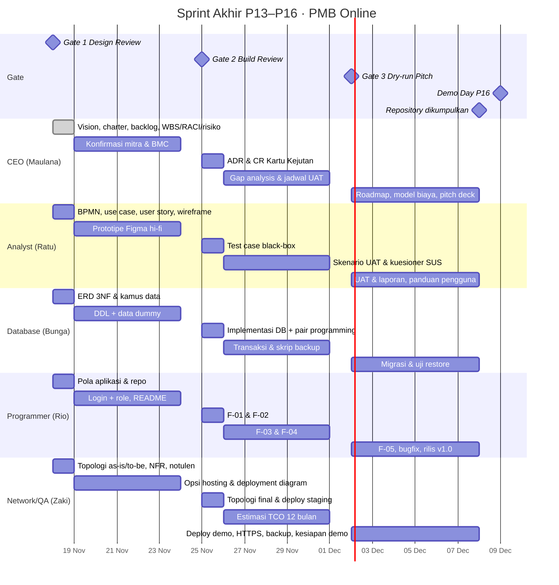

# Jadwal Gantt — PMB Online

> Disusun oleh: Maulana Umar Al-Faroq (CEO) · Direview oleh: Muhammad Zaki Rayhan (QA) · v1.0 · 18 November 2026
>
> **Asumsi tanggal:** P13 = Rabu 18 Nov 2026, lalu satu pertemuan per minggu (P14 = 25 Nov, P15 = 2 Des, P16 = 9 Des). Ganti tanggal jika jadwal kuliah berbeda.

Feature freeze di akhir P15 (2 Des). Setelah itu hanya perbaikan bug dan persiapan demo.
